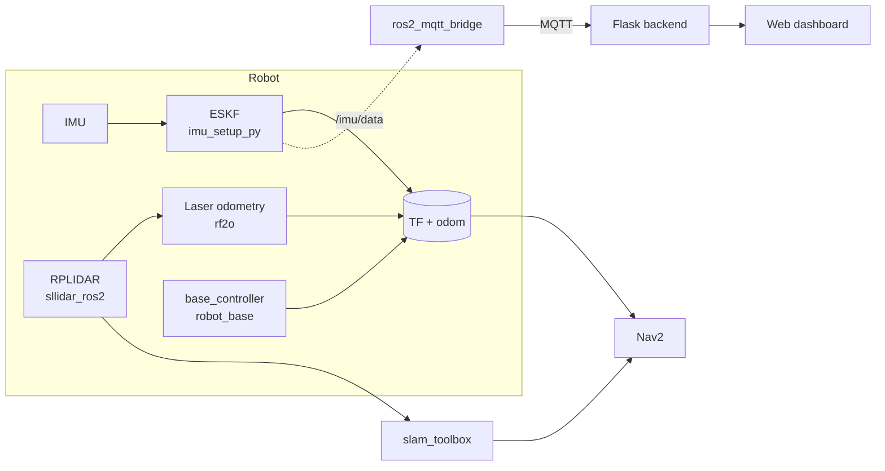

<div align="center">



**A ROS 2 differential-drive robot that maps, localizes and navigates on its own, with a live IoT dashboard and a swarm-dispatch simulation.**


</div>

---

> 🔬 **Research context:** this is the public side of the IoT-enabled autonomous mobile robot I work on as a research assistant at Symbiosis Institute of Technology. The target use is moving supplies without someone pushing a trolley: warehouse operations and hospital internal logistics. No field results are claimed here yet.

---

## ✨ What it does

| | |
|---|---|
| 🧭 **Localization** | IMU fused through an error-state Kalman filter (ESKF), plus LiDAR scan-matching odometry (RF2O) |
| 🗺️ **Mapping** | 2D SLAM with `slam_toolbox` (Cartographer config also included) using an RPLIDAR |
| 🚗 **Navigation** | Nav2 path planning with dynamic obstacle avoidance on a saved map |
| 📡 **IoT dashboard** | Browser dashboard fed by a ROS 2 → MQTT bridge: IMU, velocity commands, ETA, remote stop |
| 🐝 **Swarm dispatch** | Auction-based task allocation on top of OpenRMF, bidding on distance and completion time |

---

## 🏗️ System overview



---

## 📁 Repository layout

| Folder | Purpose |
|---|---|
| `robot_description/` | URDF / Xacro model (`tortoisebot_*`), Gazebo plugins and meshes |
| `robot_base/` | `base_controller`: motors, encoders and odometry |
| `imu_setup_py/` | IMU publisher and the ESKF localization node |
| `sllidar_ros2/` | RPLIDAR driver |
| `rf2o_laser_odometry/` | LiDAR-based odometry |
| `robot_bringup/` | Launch files and configs (`ekf.yaml`, `nav2_params.yaml`, `slam_params.yaml`) |
| `website/` | Flask backend, ROS 2 ↔ MQTT bridge and the HTML dashboard |
| `auction_house.py` | Predictive swarm auction for the OpenRMF office demo |

---

## ⚙️ Setup

Copy the packages into the `src/` folder of a ROS 2 workspace, then build:

```bash
cd ~/your_workspace
colcon build
source install/setup.bash
```

> **Before you run on hardware**
> 1. Put the robot and the remote desktop on the **same Wi-Fi network**.
> 2. Get the robot's IP for the remote session: `hostname -I` (Ubuntu).
> 3. When localizing, make sure the live laser scan lines up with the walls of the saved SLAM map.

---

## 🚀 Running the system

### 1. Bring up the base robot
Starts the hardware bridges, ESKF, LiDAR and the TF tree.

```bash
ros2 launch robot_bringup ultimate_launch.launch.py
```

### 2. Map a new environment
In a second terminal (workspace sourced):

```bash
ros2 launch slam_toolbox online_async_launch.py
```

Drive around until the map is complete in RViz, then save it from the `slam_toolbox` panel or the map-saver CLI **before** shutting the node down.

### 3. Navigate autonomously
With a saved map, start Nav2:

```bash
ros2 launch nav2_bringup bringup_launch.py \
  map:=/path/to/map.yaml \
  params_file:=/path/to/nav2_params.yaml
```

A ready-made parameter file lives in `robot_bringup/config/nav2_params.yaml`.

### 4. IoT dashboard
Keep the bringup from step 1 running, then from the `website/` folder:

```bash
python3 autobot_backend.py
python3 ros2_mqtt_bridge.py
```

Then open `autobot_dashboard.html` through the backend (the port is set in `autobot_backend.py`). An MQTT broker such as Mosquitto must be reachable from both scripts.

### 5. Swarm simulation
The swarm layer runs on [OpenRMF](https://github.com/open-rmf/rmf_demos). Install `rmf_demos`, then:

```bash
# terminal 1: the office world
ros2 launch rmf_demos_gz office.launch.xml

# terminal 2: the auction dispatcher
python3 auction_house.py
```

Enter a destination and every robot bids its total ETA: the time left on its current job plus the travel time from where it will be to the new goal. The lowest ETA wins and is dispatched through `rmf_demos_tasks`.

---

## 🛠️ Hardware

Differential-drive base (TortoiseBot-style chassis), IMU, RPLIDAR A1/A2, and a USB camera for the dashboard's vision features.

---

<div align="center">

Built as a team project · ROS 2 · Nav2 · OpenRMF

</div>
